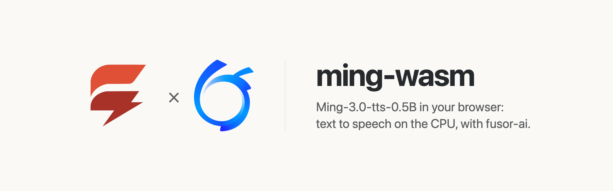

<p>
  <picture>
    <source media="(prefers-color-scheme: dark)" srcset="assets/brand/banner-dark.png">
    
  </picture>
</p>

# Text to speech in the browser, on the CPU

Type text and hear it spoken by [Ming-3.0-tts-0.5B](https://huggingface.co/inclusionAI/Ming-3.0-tts-0.5B), computed on your own device. No server, no API key, no GPU required, and once the model has loaded, nothing you type leaves the page.

ming-wasm is the app around the model: a [fusor](https://github.com/fusor-rs/fusor) page, the browser runtime and a native CLI. The model itself, compiled to WebAssembly, is built with [fusor-ai](https://github.com/fusor-rs/fusor-ai), the toolkit for AI runtimes in Rust and WebAssembly.

**In development · v0.1**: this is experimental software. See [status and known limitations](#status-and-known-limitations).

[Try it](https://ming-wasm.fusor.build) · [Get started](#get-started) · [How it works](#how-it-works) · [Documentation](#documentation) · [Status](#status-and-known-limitations) · [Contributing](CONTRIBUTING.md)

## Try it

Open [ming-wasm.fusor.build](https://ming-wasm.fusor.build) in Chrome or Edge. The page downloads the 850 MB model once and keeps it in the browser's storage, so the next visit loads in about a second. On an Apple M4 Pro it speaks 1.5–2× faster than real time.

Pick one of seven built-in voices, English or Chinese, or describe a voice in words; English numbers, money, percentages and units are read out. Audio plays while it is generated, and **Download WAV** saves it.

## Get started

You need Rust 1.99 or newer, installed with [rustup](https://rustup.rs), Node.js 22 or newer and [`just`](https://github.com/casey/just).

```sh
git clone --recurse-submodules https://github.com/fusor-rs/ming-wasm && cd ming-wasm
just ui
```

`just ui` installs the pinned tools (the threads toolchain with rustup; wasm-bindgen, binaryen and the fusor CLI into `.tools/`), builds the four browser runtimes the first time (a few minutes), builds the page and serves it on `http://localhost:8787`. The page loads the published model bundle, or the one in `dist/model` once you build your own.

### Build everything from source

```sh
just build    # also downloads the checkpoint (3 GB, sha256-checked) and compiles the bundle
just serve
```

Compiling the bundle needs about 4 GB of disk and 5 GB of free RAM: the compiler reads the whole checkpoint. `CHECKPOINT=<dir>` reuses a checkpoint you already have, and `PROFILE=q7` compiles the 1.2 GB all-7-bit bundle instead of the 850 MB default.

### Without Rust

A release has the `ming` CLI (macOS on Apple silicon, Linux on x86-64) and the page with its runtimes:

```sh
curl -fsSL https://github.com/fusor-rs/ming-wasm/releases/latest/download/install.sh | sh
version=0.1.0
curl -fsSL https://github.com/fusor-rs/ming-wasm/releases/download/v$version/ming-web-$version.tar.gz | tar -xz
cd ming-web-$version
./fetch-checkpoint.sh checkpoint && ming compile checkpoint model
node serve.mjs --mount /=.    # http://localhost:8787/
```

`install.sh` puts `ming` in `~/.ming/bin`, and `MING_INSTALL` picks another directory. The CLI also speaks without a browser: `ming say model "Hello there." -o hello.wav`.

## How it works

- **The model runs in your tab.** The runtime is Ming compiled to WebAssembly with fusor-ai: a Qwen2 language model whose output conditions a diffusion-transformer flow head, one 64-number latent per 80 ms of audio, decoded to 44.1 kHz by a streaming vocoder. Each audio frame is computed as you listen.
- **Threads and SIMD where the browser has them.** The page picks one of four builds: worker threads when it is cross-origin isolated, relaxed SIMD when the engine supports it, plain SIMD128 everywhere else.
- **Downloaded once, verified always.** The 850 MB bundle streams in parts, each checked against its BLAKE3 hash, and stays in the browser's origin-private storage for the next visit.
- **Sealed.** The runtime imports no network, storage, clock or entropy capability; fusor-ai's import check proves it on every build. The page counts its network requests during synthesis, and the count is zero.
- **A fusor page.** The form, the progress and the result are Rust signals with HTML templates; a small JavaScript module runs the engine worker and plays the audio.

## Documentation

| Guide | Covers |
| --- | --- |
| [Design](docs/plan.md) | How the model was ported: the architecture, the kernels, the threading and the parity plan |
| [Decisions](docs/decisions.md) | Where the build departs from the plan, and why |
| [Results](docs/results.md) | Parity with the PyTorch reference, and speed for every build |
| [Contributing](CONTRIBUTING.md) | Setup, checks, moving fusor-ai, and releasing |

## Status and known limitations

ming-wasm is v0.1 and experimental.

### Platform status

| Platform or capability | Status |
| --- | --- |
| Chrome and Edge, threads and relaxed SIMD | Headless Chrome end-to-end check (`just e2e`): load, speak, transcribe, revisit |
| Browsers without relaxed SIMD (Safari, older Firefox) | SIMD128 builds, checked in Node (`just smoke`) |
| Pages without cross-origin isolation | Single-threaded builds, 2.5–4× slower than real time on an Apple M4 Pro |
| Native CLI (macOS on Apple silicon, Linux on x86-64) | CI gate; release archives |
| Phones | Not measured; the threaded builds reserve 2 GB of memory |

**Not supported yet:**

- Voice cloning from a recording: it needs the VAE encoder and the CAM++ speaker model in the browser ([decisions](docs/decisions.md), D2).
- The reference's text normalizer for dates, times and abbreviations ([decisions](docs/decisions.md), D10): they are read as written.

The model's license (MIT) and its usage disclaimer apply: label synthetic speech as synthetic.

## How is this different from Kokoro.js?

[Kokoro.js](https://github.com/hexgrad/kokoro/tree/main/kokoro.js) runs the 82M-parameter Kokoro model in the browser through transformers.js, on WebGPU or WebAssembly. ming-wasm runs a model about six times larger, which also takes voices described in words, compiled into its own runtime instead of executed by a general-purpose graph runtime, on the CPU alone.

## How is this different from a cloud TTS API?

A cloud API sends your text to a server and bills per character. ming-wasm runs on your device after a one-time download: it works offline, costs nothing per sentence, and your text never leaves the page.

## Contributing

ming-wasm is an open source project in early development. The [contributing guide](CONTRIBUTING.md) covers the setup, checks and workflow. The runtime and the CLI live in `crates/` and the page in `app/`; the model and its toolkit come from fusor-ai, its crates from crates.io and its browser scripts from `vendor/fusor-ai`.

ming-wasm is built with the help of AI tools, mainly Claude Code, under the same rules the project asks of contributors: see [Using AI tools](CONTRIBUTING.md#using-ai-tools).

## License

Licensed under the [MIT License](LICENSE).
